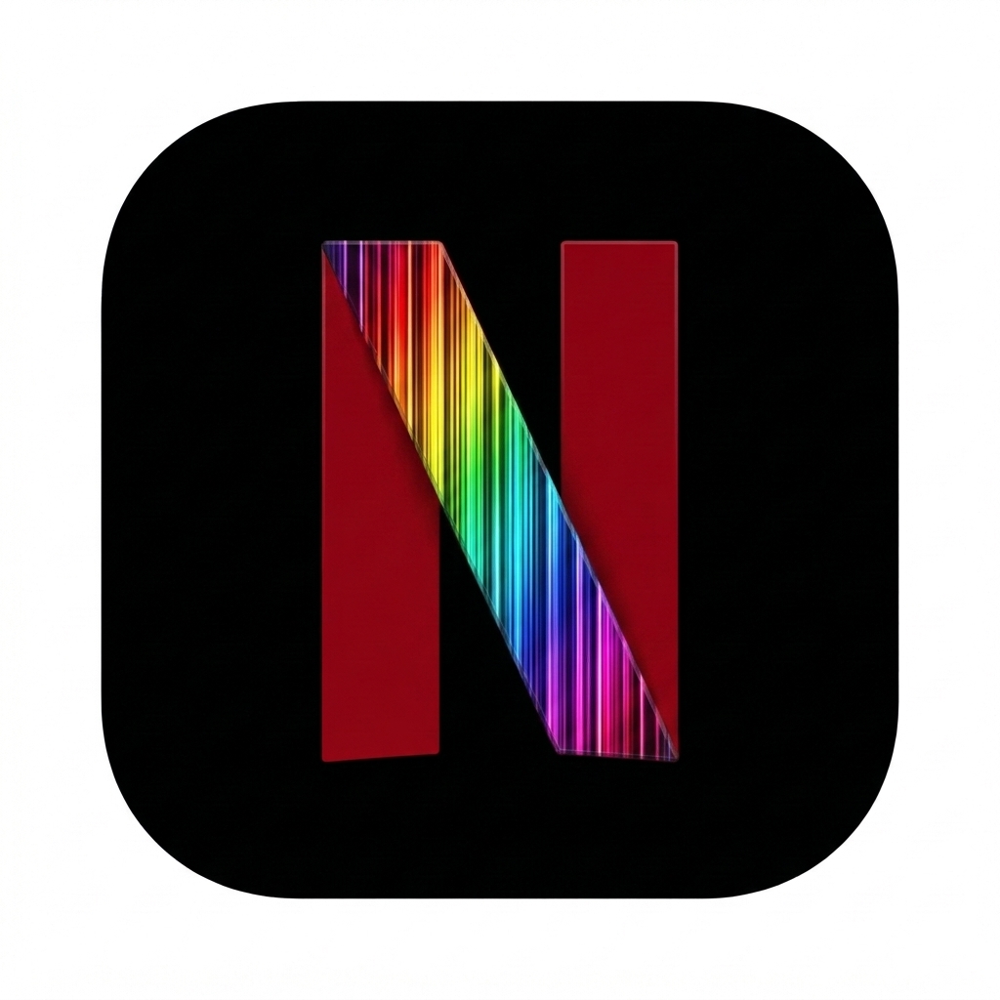

  
  <h1>OpenFlix</h1>
  
<strong>An open-source, OLED-black Android media client built with Flutter & libmpv.</strong>

  

    
    
    
    
  

---

## Screenshots

  
  
  
  
  
  
  

## Features

- **OLED-Black Cinema UI:** Matte-black interface with exact poster-by-poster carousel snapping and full responsive scaling.
- **libmpv Playback Engine:** Hardware-accelerated playback powered by `media_kit`, with an in-player **Links** switcher, Skip Intro, Play Next, and remembered audio/subtitle preferences.
- **1-Click TMDB Sync:** Sync watchlists, liked titles, curated film collections, and custom TMDB lists automatically.
- **Stremio & CloudStream Addons:** Bring your own Stremio manifests and CloudStream repositories inside a unified resolver.
- **Tuned for 3GB RAM Devices:** Capped bitmap caches and lazy collection loading keep scrolling smooth at 60fps on budget Android hardware.
- **Built-In Update Checker:** Checks GitHub Releases directly from **My OpenFlix** and pulls the matching signed APK for your architecture.

## Download

Grab the latest signed APK from the **[Download Website](https://openflix-6h8.pages.dev)** or **[GitHub Releases](https://github.com/Husnain-code-byte/OpenFlix/releases/latest)**:

| APK | Target Devices | Size |
| :--- | :--- | :--- |
| `arm64-v8a` *(Recommended)* | Modern 64-bit Android smartphones | ~78 MB |
| `universal` | Older 32-bit or unknown devices | ~117 MB |

## Community & Feedback

Found a bug or want to suggest a feature for upcoming releases? Open a [GitHub Issue](https://github.com/Husnain-code-byte/OpenFlix/issues) or join the [Discord server](https://discord.gg/y5QssSBcpJ).

## Disclaimer

OpenFlix is strictly a media client and metadata browser. It does not host, provide, or distribute any media content. Users are solely responsible for any third-party addons or repositories they configure.
